# FREATIVE
THE FROM + CREATIVE = FREATIVE

> **모든 Creative는 나로부터 시작된다.**
> 더프롬의 철학과 방법론으로 크리에이티브 컨셉을 도출하는 Windows · macOS 설치형 데스크톱 툴.

<p align="center">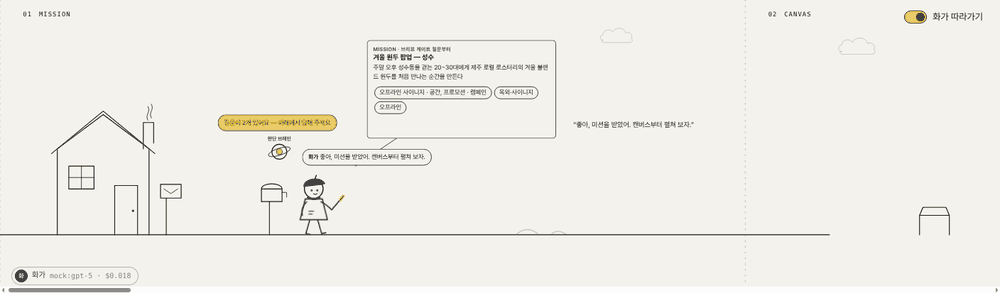</p>

화가가 미션을 받고 → 캔버스를 펼치고 → 타임머신 비행기로 사조를 여행하고 → 차를 타고 터널에서 인사이트를 겹치고 → 언덕 위에서 지도를 펼치고 → 새 캔버스에 컨셉을 그려 → 갤러리에 겁니다. 선 하나가 처음부터 끝까지 이어지는 횡스크롤 라인 드로잉으로, **추론의 흐름 전체**를 보여줍니다.

- [무엇인가](#무엇인가) · [흐름](#흐름--8개의-장면) · [더프롬 판단 브레인](#더프롬-판단-브레인) · [화면](#화면)
- [설치](#설치) · [쓰는 법](#쓰는-법) · [업데이트](#업데이트--두-갈래) · [개발](#개발) · [구조](#구조) · [다음 — 중앙관제](#다음--중앙관제)

---

## 무엇인가

더프롬 UX 스킬 [`thefrom-ux`](https://github.com/FROM-i/thefrom_design_Skill)의 철학 · 방법론 · 노하우를 **그대로 담아**, UI/UX에서 **범용 크리에이티브**로 넓힌 도구입니다.

| 결과물 유형 | |
|---|---|
| 제안 Creative 컨셉 · 광고 소재 · 영상 · UI/UX | 피처 이미지(KV) · 웹페이지/랜딩 · 오프라인 사이니지/공간 · 프로모션/캠페인 |

| 스킬(thefrom-ux)에서 그대로 | FREATIVE에서 더한 것 |
|---|---|
| 관성은 구조에서, 새로움은 해석에서 · 판단은 사람, 연산은 AI · 증거는 지어내지 않는다 · N7 | **더프롬 판단 브레인** — 철학을 렌즈로 바꿔 단계마다 방향 제시 · 검증 |
| 브리프 게이트 ★1~6 | 디자이너용 간략 폼 + 첨부(.md · 이미지 권장) |
| Airplane — 사조 여행 | 사조마다 조수(서브 모델) 1명이 **병렬로** 여행 |
| Tunnel — 레이어링 | 시장 · 브랜드 · 타겟 · 사용 습관 4레이어 병렬 |
| C 게이트 | **Positioning Map** 5→4→3→1 · **FoR/PoP/PoD** 발상의 전환 5→3→1 · **Concept** 5→3→1 |
| 375px 프로토타입 | 유형별 **Creative 가이드 3~5종** + 콘셉트 비주얼 · **PPT 리포트** |

### 두 저장소

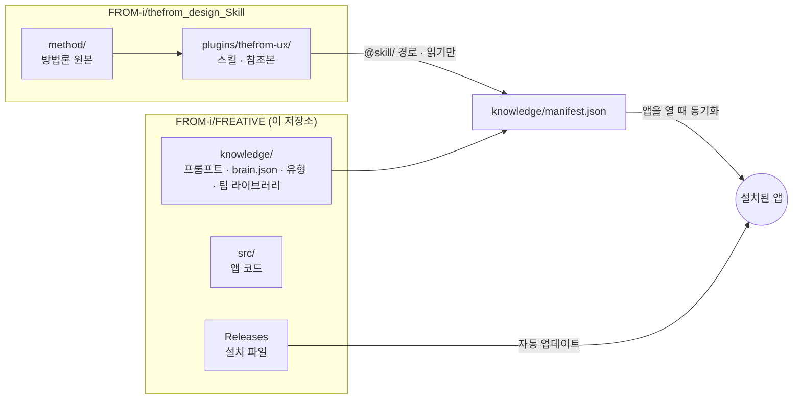

방법론을 고치면 **스킬 저장소만**, 사고 흐름(프롬프트 · 브레인)을 고치면 **이 저장소만** 고칩니다. 방법론의 원본은 하나뿐입니다.

---

## 흐름 — 8개의 장면

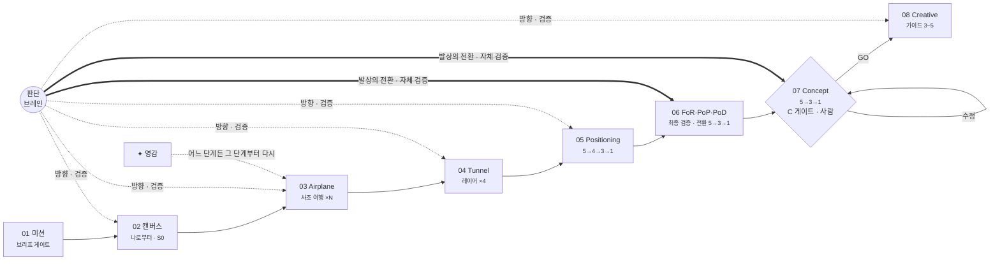

| 장면 | 하는 일 | 주체 |
|---|---|---|
| **01 미션** | 폼 · 첨부를 읽고 미션 정리, 사조 · 레이어 · 모델 배정 계획. ★1·2가 모호하면 최대 3개 질문 | 화가 |
| **02 캔버스** | **나로부터** — 우리의 관점 한 줄, 컨셉 한 문장 초안, 지킬 관성, 반대 대상 | 화가 |
| **03 Airplane** | 사조마다 원리 채집 — 가져올 것 · 두고 올 것 · A3 → 착륙해 하이브리드 | 조수 ×N → 화가 |
| **04 Tunnel** | 시장 · 브랜드 · 타겟 · 사용 습관을 겹친다. 겹칠수록 터널이 밝아진다 | 조수 ×4 → 화가 |
| **05 Positioning** | 표현의 두 축, 통상적 해석, 빈자리 → 영역 5→4→3→1 | 화가 |
| **06 FoR · PoP · PoD** | **앞선 모든 단계 최종 검증** → 준거 틀 · 동등점 · 차별점 후보 5 → **발상의 전환** 2회로 5→3→1 | 화가 + 브레인 |
| **07 Concept** | 5안 → 1차 3안 → **브레인 자체 검증** → 1안. 철학이 코어. **C 게이트는 사람** | 화가 + 브레인 → 사람 |
| **08 Creative** | A 시스템 주도 / B 경험 주도 가이드 3~5종 · 디테일 3층 이미지 가이드 · 콘셉트 비주얼 | 화가 + 이미지 조수 |

---

## 더프롬 판단 브레인

더프롬 철학을 **판단 렌즈 10개**로 바꾼 엔진입니다. 결과물을 만들지 않고 **판단합니다.**

<p align="center">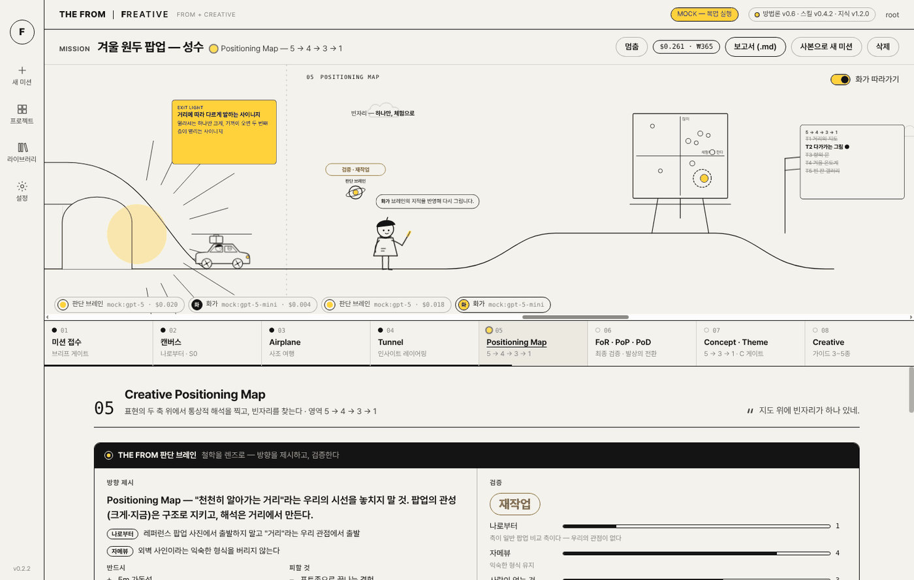</p>

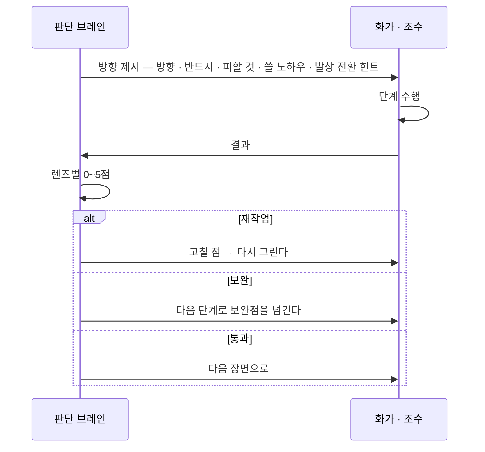

| 렌즈 | 질문 |
|---|---|
| **나로부터** | 판단의 출발점이 레퍼런스·트렌드가 아니라 우리의 관점인가 |
| **자메뷰** | 익숙한데 처음 보는 것 같은가 — 낯선 구조 대신 새로운 해석 |
| **관성은 구조, 새로움은 해석** | 지킬 것과 바꿀 것이 분리되어 있는가 |
| **1U — 하나에서 파생** | 모든 결정이 하나의 코어에서 나오는가 |
| **노랑 — 전 세대의 태도** | 누가 배제되지 않는가 |
| **근본 있는 하이브리드** | 사조를 원리 층위에서 가져왔는가, 두고 올 것을 적었는가 |
| **터널의 빛** | 레이어가 모두 겹쳐 범위가 좁혀졌는가 |
| **사람이 얻는 것** | 효익이 빈 결정(개살구)은 없는가 |
| **N7** | 더프롬의 형상·컬러가 결과물의 소재가 되지 않았는가 |
| **조형 완성도** | 포트폴리오에 올릴 수준인가 |

- 노하우북 **175항목**을 이미지뿐 아니라 **구조화**(대비 · 강조 · 균형 · 비율로 축과 좁히기 설계)에도 씁니다. 브레인이 단계마다 고르고, 고른 항목의 원문이 그 단계에 들어갑니다.
- 렌즈 · 개입 단계 · 노하우 범위는 [`knowledge/brain.json`](knowledge/brain.json) 하나로 관리합니다.
- 개입 강도(표준 / 핵심 / 끔)와 재작업 횟수는 설정에서 바꿉니다.

---

## 화면

| | |
|---|---|
| **미션 접수** — 필수 6칸 + 첨부, 브리프 게이트 미리보기<br/>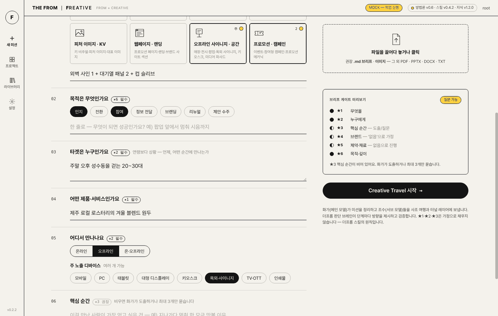 | **Airplane** — 연표 위를 나는 타임머신 비행기, 섬마다 조수<br/>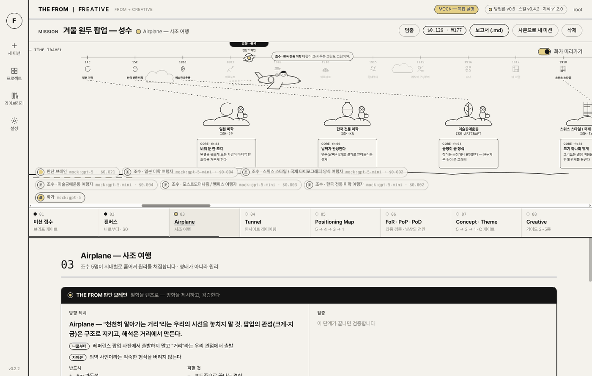 |
| **Tunnel** — 레이어가 겹칠수록 밝아지는 터널<br/>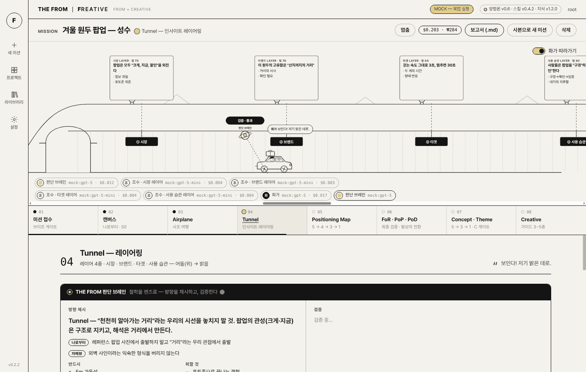 | **FoR · PoP · PoD** — 발상의 전환으로 5 → 3 → 1<br/>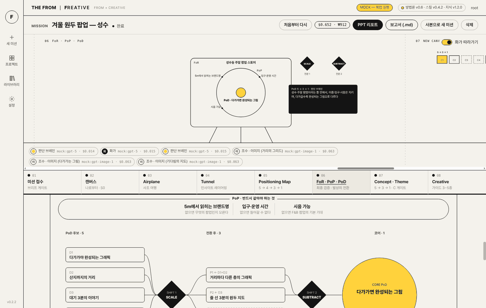 |
| **Concept** — 브레인 자체 검증 (철학 렌즈 0~5)<br/>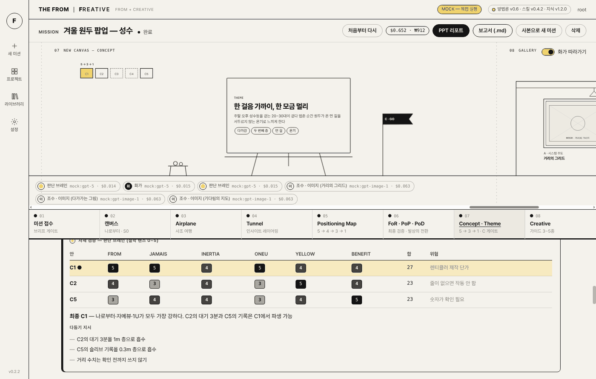 | **Creative 가이드** — 코어에서 파생 · 디테일 3층<br/>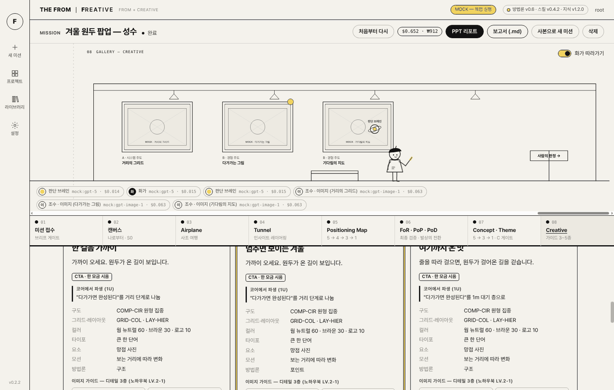 |
| **라이브러리 · 판단 브레인** — 사조·노하우 추가, 렌즈 보기<br/>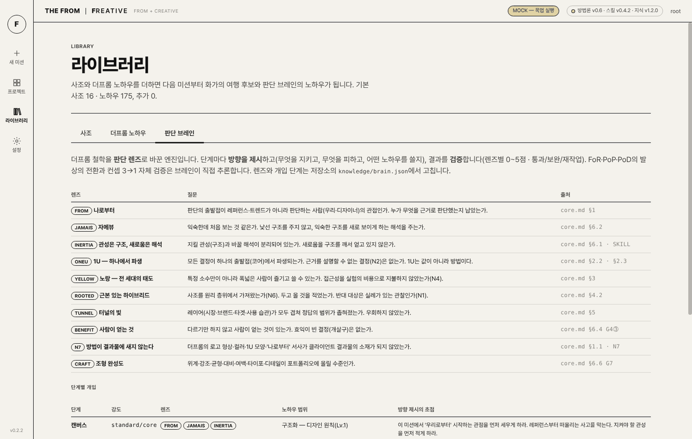 | **API 비용** — 실시간 · 월별 · 단가 설정<br/>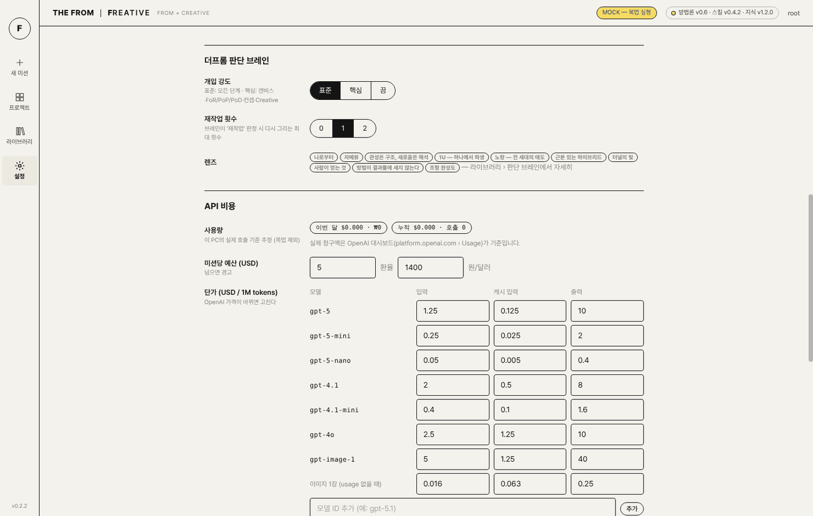 |

**PPT 리포트** — 전체 흐름의 코어만 추출해 Pretendard 16:9로

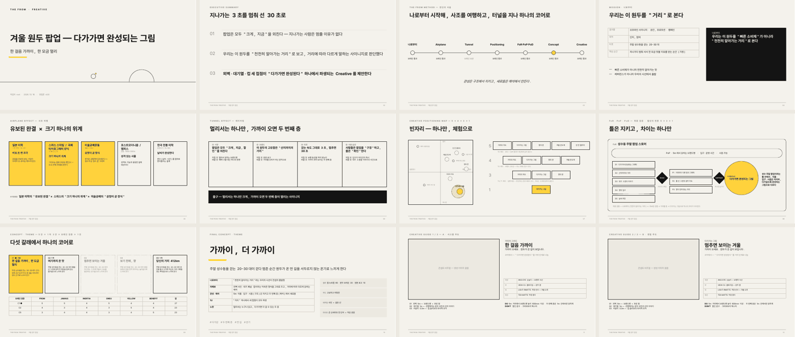

---

## 설치

[**Releases**](https://github.com/FROM-i/FREATIVE/releases)에서 받습니다.

| OS | 파일 | 처음 실행 |
|---|---|---|
| Windows | `THEFROM-FREATIVE-Setup-<버전>.exe` | 서명 전이라 SmartScreen이 뜨면 *추가 정보 → 실행* |
| macOS | `THEFROM-FREATIVE-<버전>-arm64.dmg` (Apple Silicon) · `-x64.dmg` (Intel) | 서명 전이면 *우클릭 → 열기* |

처음 열면 **설정 → OpenAI API 키**를 넣습니다(이 PC의 키체인으로 암호화 저장). 키 없이 화면만 보려면 개발 모드의 `npm run mock`.

## 쓰는 법

1. **새 미션** — 작업자 · 프로젝트명 · 필수 6칸(무엇을 · 목적 · 타겟 · 제품/서비스 · 채널 · 디바이스)을 채우고 브리프 `.md`나 이미지를 끌어다 놓습니다.
2. **Creative Travel 시작** — 위에서 화가 · 조수 · 브레인이 움직이고, 아래 패널에 단계별 리포트가 쌓입니다.
3. 화가가 질문하면(브리프 게이트) 선택지로 답합니다.
4. **C 게이트** — 5→3→1로 좁혀진 컨셉 · 테마를 보고 `GO` / `수정 요청` / `중단`.
5. **✦ 영감** — 어느 단계든 리포트 아래에 떠오른 것을 적으면 그 단계부터 다시 그립니다(이전 결과는 버전으로 남음).
6. **PPT 리포트 · 보고서(.md)** 로 내보냅니다.
7. **라이브러리** — 사조 · 노하우 자료를 올리면 카탈로그 형식으로 추출해 추가합니다.

비용은 실행 화면 상단에 실시간(USD · 원), 누적은 설정 › API 비용에 표시됩니다. 단가는 설정에서 고치는 추정치이고, 실제 청구는 OpenAI 대시보드가 기준입니다.

모델은 설정의 기본값(화가 · 브레인 · 조수 · 이미지)과 모델 풀 안에서 **화가가 미션을 보고 단계마다 직접 배정**합니다.

---

## 업데이트 — 두 갈래

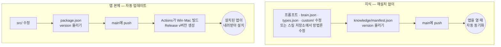

| 무엇을 | 어떻게 |
|---|---|
| 프롬프트 · 판단 브레인 · 결과물 유형 · 팀 라이브러리 | `knowledge/` 수정 → `knowledge/manifest.json`의 `version` 올리기 → push |
| 방법론 | 스킬 저장소에서 수정 · push → 이 저장소 `knowledge/manifest.json`의 `version` 올리기 → push |
| 앱 코드 | `package.json`의 `version` 올리기 → push. 같은 버전의 Release가 없을 때만 빌드한다 |

자세한 절차와 서명 · 비공개 저장소 설정은 [`docs/RELEASE.md`](docs/RELEASE.md).

---

## 개발

```bash
git clone https://github.com/FROM-i/FREATIVE
git clone https://github.com/FROM-i/thefrom_design_Skill   # 옆 폴더에 두면 빌드가 스킬 원본을 여기서 읽는다 (없으면 GitHub에서 내려받음)
cd FREATIVE
npm install
npm run mock      # API 키 없이 목업으로 화면 · 흐름 확인
npm start         # 실제 GPT로 실행
npm test          # 헤드리스 점검 — 프롬프트 참조 해석 + 전체 흐름(목업) · 영감 재시작 · PPT · 라이브러리  (Linux는 xvfb-run)
npm run dist:win  # Windows 설치 파일 → dist/
npm run dist:mac  # macOS 설치 파일 (macOS에서)
```

## 구조

```
FREATIVE/
  .github/workflows/release.yml   버전이 오른 push → Windows · macOS 빌드 · Release
  src/main/
    main.js · ipc.js              창 · 렌더러 요청(모두 auth.can 권한 확인)
    orchestrator/                 화가 · 조수 · 판단 브레인 오케스트레이션 · 게이트 · 영감 재시작
    knowledge.js                  지식 동기화(앱 저장소 + @skill/ 스킬 저장소) · 사조 · 노하우 파싱
    library.js                    사조 · 노하우 업로드 → 추출 → 저장
    cost.js                       호출별 비용 계산 · 장부
    report.js · report-ppt.js     .md 보고서 · PPT 리포트
    providers/                    openai.js(GPT) · mock.js — 공급자 추가 지점
    services/auth.js · storage.js 사용자 · 조직 · 팀 · 권한 / 프로젝트 저장 — 중앙관제로 교체 지점
  src/renderer/                   화면 (빌드 단계 없는 ES 모듈)
    js/journey.js · art.js        횡스크롤 라인 드로잉 여정 · 화가 · 조수 · 브레인 · 비행기 · 차
    js/panels.js                  단계 리포트 · 포지셔닝 맵 · 발상의 전환 플로우 · 브레인 카드
  knowledge/
    manifest.json                 동기화 목록 · version
    prompts/                      단계별 프롬프트 ({{include:파일#절}}로 스킬 원문 인용)
    brain.json                    판단 브레인 렌즈 · 개입 단계 · 노하우 범위
    types.json                    결과물 유형 8종
    custom/                       팀 공유 사조 · 노하우
  docs/ARCHITECTURE.md · RELEASE.md
  supabase/schema.sql             중앙관제 스키마 초안
```

## 다음 — 중앙관제

지금은 PC마다 로컬로 저장합니다. 확장을 위해 이음새를 미리 깔아 두었습니다.

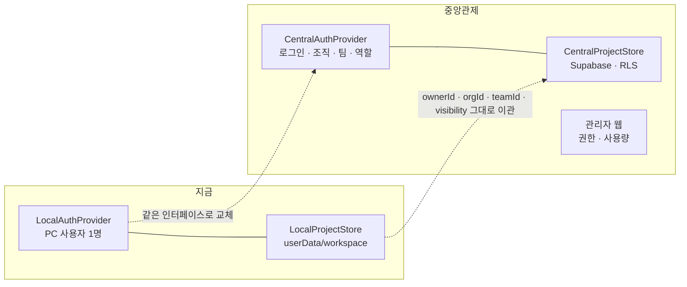

1. 권한 체크와 조직 · 팀 단위 로그인 / 회원 관리 — `services/auth.js`의 `AuthProvider`와 `can()` 역할 표(owner · admin · lead · designer · viewer)
2. 작업물 · 결과물의 조직 · 팀 단위 통합 관리 — `services/storage.js`의 `ProjectStore`, [`supabase/schema.sql`](supabase/schema.sql)

설계는 [`docs/ARCHITECTURE.md`](docs/ARCHITECTURE.md).

---

AI가 내린 판정은 모두 **예비 판정**입니다. C 게이트와 조형 완성도의 최종 판정은 사람이 합니다.
