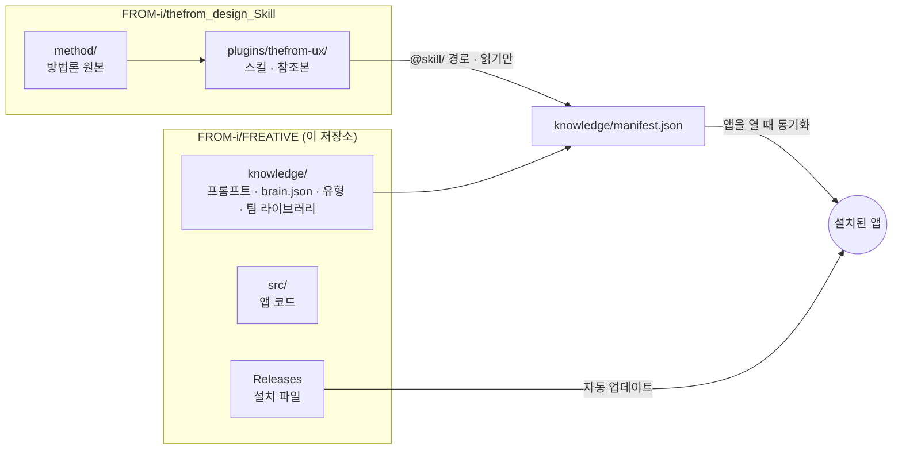
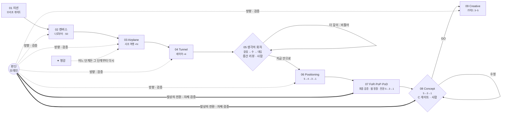
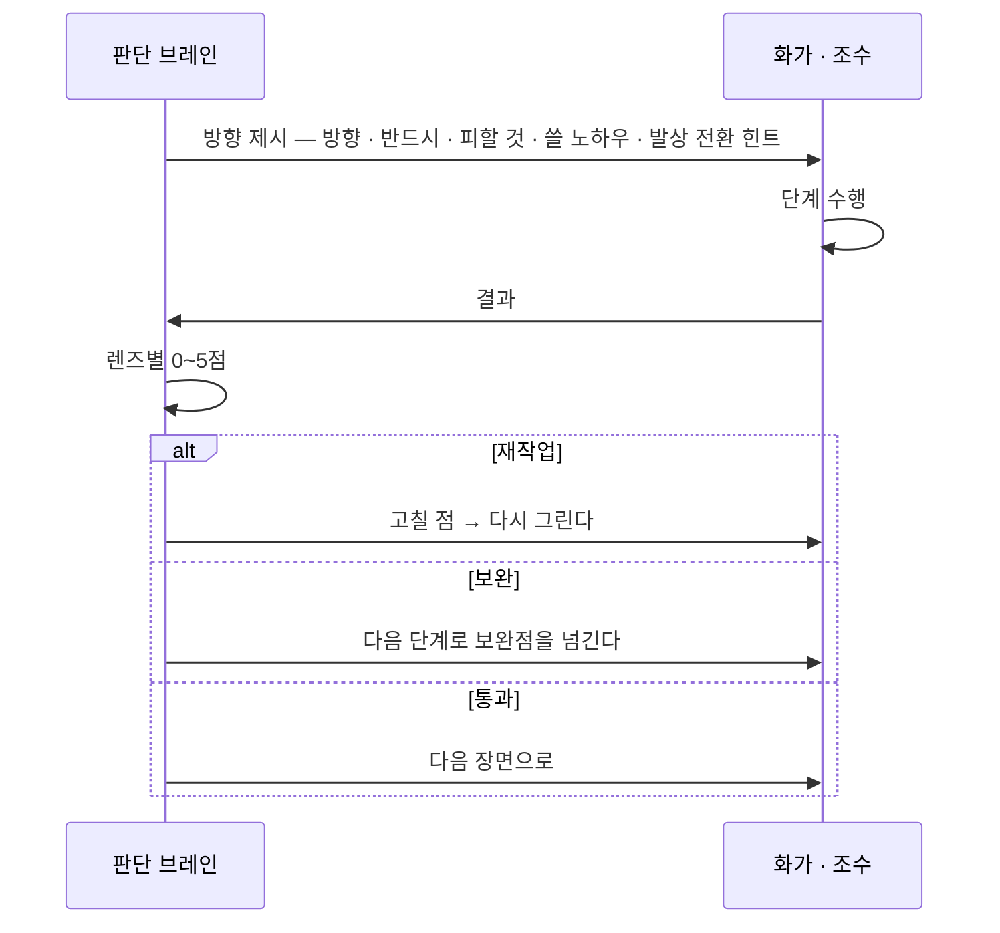
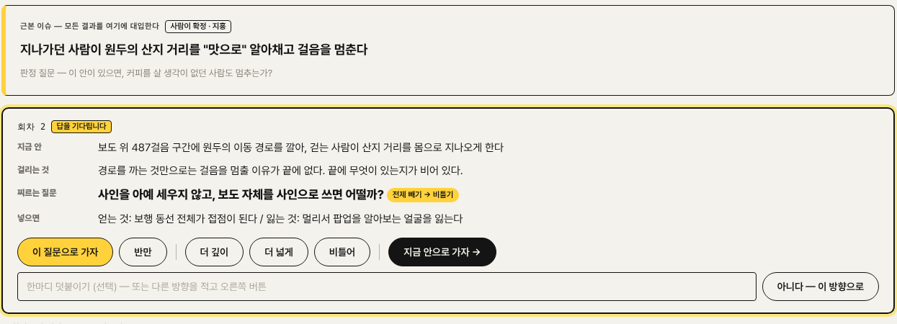
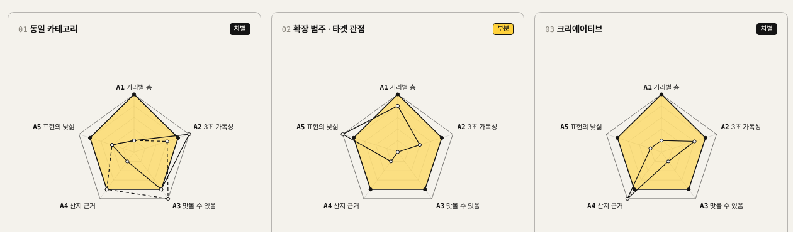
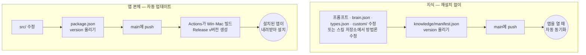
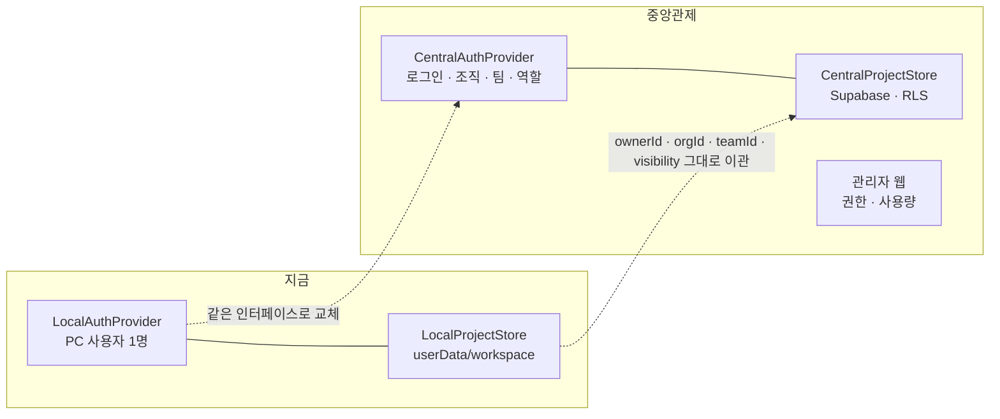

# FREATIVE
THE FROM + CREATIVE = FREATIVE

> **모든 Creative는 나로부터 시작된다.**
> 더프롬의 철학과 방법론으로 크리에이티브 컨셉을 도출하는 Windows · macOS 설치형 데스크톱 툴.

<p align="center"></p>

화가가 미션을 받고 → 캔버스를 펼치고 → 타임머신 비행기로 사조를 여행하고 → 차를 타고 터널에서 인사이트를 겹치고 → 언덕 위에서 지도를 펼치고 → 새 캔버스에 컨셉을 그려 → 갤러리에 겁니다. 선 하나가 처음부터 끝까지 이어지는 횡스크롤 라인 드로잉으로, **추론의 흐름 전체**를 보여줍니다.

- [무엇인가](#무엇인가) · [흐름](#흐름--8개의-장면) · [더프롬 판단 브레인](#더프롬-판단-브레인) · [화면](#화면)
- [설치](#설치) · [쓰는 법](#쓰는-법) · [업데이트](#업데이트--두-갈래) · [개발](#개발) · [구조](#구조) · [다음 — 중앙관제](#다음--중앙관제)

---

## 무엇인가

더프롬 UX 스킬 [`thefrom-ux`](https://github.com/FROM-i/thefrom_design_Skill)의 철학 · 방법론 · 노하우를 **그대로 담아**, UI/UX에서 **범용 크리에이티브**로 넓힌 도구입니다.

| 결과물 유형 | |
|---|---|
| 제안 Creative 컨셉 · 광고 소재 · 영상 · UI/UX | 피처 이미지(KV) · 웹페이지/랜딩 · 오프라인 사이니지/공간 · 프로모션/캠페인 |

| 스킬(thefrom-ux)에서 그대로 | FREATIVE에서 더한 것 |
|---|---|
| 관성은 구조에서, 새로움은 해석에서 · 판단은 사람, 연산은 AI · 증거는 지어내지 않는다 · N7 | **더프롬 판단 브레인** — 철학을 렌즈로 바꿔 단계마다 방향 제시 · 검증 |
| 브리프 게이트 ★1~6 | 디자이너용 간략 폼 + 첨부(.md · 이미지 권장) |
| Airplane — 사조 여행 | 사조마다 조수(서브 모델) 1명이 **병렬로** 여행 |
| Tunnel — 레이어링 | 시장 · 브랜드 · 타겟 · 사용 습관 4레이어 병렬 |
| C 게이트 | **Positioning Map** 5→4→3→1 · **FoR/PoP/PoD** 발상의 전환 5→3→1 · **Concept** 5→3→1 |
| 375px 프로토타입 | 유형별 **Creative 가이드 3~5종** + 콘셉트 비주얼 · **PPT 리포트** |

### 두 저장소



방법론을 고치면 **스킬 저장소만**, 사고 흐름(프롬프트 · 브레인)을 고치면 **이 저장소만** 고칩니다. 방법론의 원본은 하나뿐입니다.

---

## 흐름 — 9개의 장면



| 장면 | 하는 일 | 주체 |
|---|---|---|
| **01 미션** | 폼 · 첨부를 읽고 미션 정리, 사조 · 레이어 · 모델 배정 계획. ★1·2가 모호하면 최대 3개 질문. **근본 이슈** 후보(과업 → 목적 → 근본 이슈) 2~3개 → 사람이 확정 | 화가 → 사람 |
| **02 캔버스** | **나로부터** — 우리의 관점 한 줄, 컨셉 한 문장 초안, 지킬 관성, 반대 대상 | 화가 |
| **03 Airplane** | 사조마다 원리 채집 — 가져올 것 · 두고 올 것 · A3 → 착륙해 하이브리드 | 조수 ×N → 화가 |
| **04 Tunnel** | 시장 · 브랜드 · 타겟 · 사용 습관을 겹친다. 겹칠수록 터널이 밝아진다 | 조수 ×4 → 화가 |
| **05 생각의 회차** | 회차마다 **걸림**(이 안이 뻔해지는 이유) → **수**(깊이 · 넓이 · 비틀기 · 조합) → **근본 이슈에 대입**(행동·시간·장소로 무엇이 달라지나) → 판단 브레인이 **찌르는 질문** 하나를 골라 **중간 리뷰 카드** → 사람이 한마디로 방향을 튼다 | 화가 + 브레인 → 사람 |
| **06 Positioning** | 표현의 두 축, 통상적 해석, 빈자리 → 영역 5→4→3→1 | 화가 |
| **07 FoR · PoP · PoD** | **앞선 모든 단계 최종 검증** → FoR 네 방식(좁히기·현재·넓히기·전환) · PoP(카테고리·경쟁·상관) · PoD 후보 5(삼각형) → **조수 웹 정찰 3범위**(동일 카테고리 · 확장 범주 · 크리에이티브) → **발상의 전환** 2회로 5→3→1 → 브레인이 **공통 범례 오각형/삼각형**으로 차별성 판정 · 포지셔닝 진술문 | 화가 + 조수 + 브레인 |
| **08 Concept** | 5안 → 1차 3안 → **브레인 자체 검증** → 1안. 철학이 코어. **C 게이트는 사람** | 화가 + 브레인 → 사람 |
| **09 Creative** | A 시스템 주도 / B 경험 주도 가이드 3~5종 · 디테일 3층 이미지 가이드 · 콘셉트 비주얼 | 화가 + 이미지 조수 |

---

## 더프롬 판단 브레인

더프롬 철학을 **판단 렌즈 10개**로 바꾼 엔진입니다. 결과물을 만들지 않고 **판단합니다.**

<p align="center"></p>



| 렌즈 | 질문 |
|---|---|
| **나로부터** | 판단의 출발점이 레퍼런스·트렌드가 아니라 우리의 관점인가 |
| **자메뷰** | 익숙한데 처음 보는 것 같은가 — 낯선 구조 대신 새로운 해석 |
| **관성은 구조, 새로움은 해석** | 지킬 것과 바꿀 것이 분리되어 있는가 |
| **1U — 하나에서 파생** | 모든 결정이 하나의 코어에서 나오는가 |
| **노랑 — 전 세대의 태도** | 누가 배제되지 않는가 |
| **근본 있는 하이브리드** | 사조를 원리 층위에서 가져왔는가, 두고 올 것을 적었는가 |
| **터널의 빛** | 레이어가 모두 겹쳐 범위가 좁혀졌는가 |
| **사람이 얻는 것** | 효익이 빈 결정(개살구)은 없는가 |
| **N7** | 더프롬의 형상·컬러가 결과물의 소재가 되지 않았는가 |
| **조형 완성도** | 포트폴리오에 올릴 수준인가 |

- **생각의 회차 — 걸러내지 말고 생각하게 (v0.5)** — 검증(문)만으로는 문을 통과하는 가장 안전한 답이 나온다. 그래서 사람이 생각하는 방식을 단계로 넣었다:
  - 브리프 직후 **근본 이슈**를 세우고 사람이 확정한다. 이후 모든 단계의 지시에 "결과가 근본 이슈에서 누구의 무엇을 바꾸는가"가 붙는다.
  - Tunnel 뒤 **생각의 회차**: 정해진 순서 대신, 지금 안에서 걸리는 것을 보고 깊이 · 넓이 · 비틀기(주체·시간·방향·크기) · 조합 중 다음 수를 고른다. 대입을 쓰지 못한 수는 버린다.
  - 회차마다 **중간 리뷰 카드**(지금 안 / 걸리는 것 / 찌르는 질문 / 넣으면, 400자) — 질문은 전제 빼기 · 극단 밀기 · 반대편 서기 · 하나만 남기기 · 실패 먼저 중 하나. 답: 이 질문으로 · 반만 · 더 깊이 · 더 넓게 · 비틀어 · 지금 안으로 · 다른 방향.
  - 판단 브레인은 이 단계에서 심판이 아니라 **편집장** — 질문을 고르고 방향을 준다. 설정에서 리뷰를 '자동'으로 두면 브레인 제안대로 진행하고 기록만 남긴다.
  - 사고 방식 정의는 [`knowledge/method/thinking.md`](knowledge/method/thinking.md) — 다른 AI 파이프라인에도 그대로 붙일 수 있게 썼다(7장 체크리스트 · 붙여 넣는 프롬프트).

  
- **펼치기 — 뻔한 답을 막는 장치 (v0.4)** — 좁히기(5→1)만으로는 "입구에 사인 하나"가 나온다. 그래서:
  - 브리프에서 **사업 범위**를 항목으로 쪼개고, **기본안(아무나 내는 답)**을 먼저 적는다. 컨셉·설계가 기본안과 같으면 자동으로 다시 그린다.
  - 결과물 유형마다 **관성(지킬 구조)과 해석(바꿀 것)의 경계**를 정의한다 — 사이니지에서 조형·재료·빛·배치·콘텐츠는 해석이다.
  - 사조 여행이 **조형 조작**(만드는 방법 + 피할 겉모양)을 내고, 터널에 **현장 조건 · 운영 · 선행 사례(웹)** 레이어가 붙는다.
  - GO 이후 **설계 단계**: 해부도 절(사인 체계·배치·조형·콘텐츠·인터랙션·운영)마다 조수가 병렬로 깊게 그리고 화가가 통합 — 범위·최소 항목·필수 요소가 빠지면 그 절만 보완한다. Creative는 설계에서 나온 **서로 다른 핵심 접점** 장면.
- **프로젝트 파일 · 과정 다시 보기 (v0.7)** — 실행 화면의 `프로젝트 파일로 내보내기`가 결과와 과정을 담은 `.freative` 파일 하나를 만든다(첨부는 넣을지 고른다 · API 키·설정·비용 장부는 넣지 않는다). 다른 PC의 프로젝트 화면에 끌어다 놓거나 `프로젝트 파일 열기`로 열면 새 프로젝트로 들어오고, 바로 **과정 다시 보기**가 시작된다 — 실행 기록의 시각대로 여정 애니메이션 · 단계 패널 · 조수 줄 · 브레인 판정 · 회차 카드가 그때 순서로 다시 나온다(1×~8×, 구간 이동). 영감·수정 요청으로 다시 그린 단계도 그 전의 결과로 보인다. 통합 중앙 관리 전까지 프로젝트를 옮기는 단위다.
- **가이드 이미지 그리기 (v0.7.1)** — 카드의 `그리기`는 자동 생성 스위치(설정 · 의뢰서 · 결과물 유형)와 상관없이 그 한 장을 그린다. 자동으로 그리지 않았으면 카드에 그 이유가 나오고, 실패하면 실패 사유가 나온다. 여러 유형을 고르면 하나라도 이미지를 쓰는 유형이면 자동으로 그린다. '직접 지정' 모델에서 이미지 칸이 비었거나 글 모델이 들어가 있으면 추천 이미지 모델로 대신 그린다.
- **설계론 · 사조의 미감 · 모델 프리셋 (v0.10)**
  - 설정에 **모델 세팅 프리셋 1~5단계**(검토 · 가벼운 분석 · 표준 · 강화 · 최고). 고르면 역할 모델 · 추론 강도 · 단계 지정 · 실행 설정이 한 번에 바뀌고, 예상 비용(컨셉 게이트까지 / Creative 포함)이 함께 보인다. API에서 내려간 `gpt-image-1`은 선택지·대체 모델에서 뺐고, 저장된 값이면 기본 이미지 모델로 바꾼다.
  - 사조: 원리가 먼저이되 **미감은 판단해서 가져온다**(효익 · 변형 · 범위 · 원리와 같은 방향의 네 조건). 하이브리드에서 미감을 골라 가방에 넣고 설계론까지 넘긴다.
  - 컨셉은 기획이 아니라 Creative다 — 다섯 안마다 `visual`, 최종 키트에 `creative_edge`(익숙한 것 → 새 표현) · `visual_idea`. 포지셔닝 축 하나는 눈에 보이는 표현의 축.
  - Creative에 **설계론** 단계: 이 Creative는 어떻게 보이는가. UI면 시그니처 컴포넌트·레이아웃(익숙한 패턴에서 출발해 사조의 원리·미감으로 다룬 것)과 시스템, 그림이면 아트 디렉션. 근거 사슬(사조 원리·미감 · 노하우 · 인사이트 → 무엇이 되었나)과 설계론을 구현한 **예시 이미지**를 낸다. 장면과 모든 이미지는 설계론을 따르고, UI는 기기 사진이 아니라 평면 화면 렌더로 그린다. UI/UX 유형도 이미지를 쓴다.
  - 브레인은 기획으로만 끝난 Creative를 재작업으로 돌리고, 재작업은 설계론과 장면만 다시 그린다. 보고서 · PPT에 설계론 · 콘텐츠 · 예시 이미지 장을 넣었다.
- **기존의 것을 다루는 방식 · 콘텐츠 (v0.9)**
  - 방법론의 기준을 "새로운가"에서 "기존의 것을 근거 있게 다뤘는가"로 바꿨다. 사조 조수는 정해진 전술·관습·기본안을 버리지 않고 `treatments`로 다룬다 — 지킨다 · 다시 읽는다 · 옮긴다 · 잇는다 · 덜어낸다, 그리고 어느 원리로. A4는 '새로움 시험'이 아니라 '원리 추적 시험'이다. 브레인은 기존 요소를 썼다고 감점하지 않고, 다루는 방식이 달라졌는지를 본다.
  - Creative에 **콘텐츠** 단계를 넣었다. 설계서는 그릇(체계·규칙)이고, 사람이 실제로 보고 하는 것(화면·면의 내용, 예시 문구, 행동)은 따로 만든다. 콘텐츠마다 재료로 삼은 기존 것 → 사조의 처리 → 겹친 인사이트 → 노하우 → 흔한 방식과 다른 점이 남는다.
  - 핵심 장면은 사물 목업이 아니라 **콘텐츠가 보이는 순간**이다. 조형은 일반 유형(토템·사각 패널·기둥형 키오스크)을 사조의 처리로 어떻게 다뤘는지(`form_language.departures`)에서 나오고, 이미지 프롬프트도 그것을 따른다.
- **비용·중복·사실 가드 (v0.8)**
  - 웹 정찰: 검색 도구와 JSON 모드를 같이 걸어 모든 정찰이 400으로 실패하던 버그를 고쳤다. 정찰은 낮은 추론·적은 검색 분량·호출당 검색 4회 상한으로 돌리고, 같은 정찰은 실행 안에서 다시 검색하지 않는다. 레이어 정찰이 실패하면 웹 없이 한 번 더 둔다. 정찰에서 확인한 사례가 없으면 차별성 점수를 매기지 않는다.
  - Creative: 절을 그리기 전에 **공통 원장**(공통 규칙·주제의 주인·정할 값)을 한 번 만들어 절끼리 같은 규칙을 각자 다르게 쓰지 않게 한다. 브레인의 재작업은 짚은 절만 다시 그리고, 장면은 장면을 짚은 지적이 있을 때만 다시 그린다. 새로 고칠 곳이 없는 재작업은 돌지 않는다. 장면 호출에는 계보·터널 요약만 준다.
  - 사실 가드: 브리프·첨부·사람의 답·웹 정찰에 근거가 없는 수치(치수·각도·기간·등급)는 '(값 미정 · 목업)'으로 바꾸고, 문장 끝의 "예비 판정입니다 / 판단자는 FREATIVE / 출처: 브리프·추론" 고지는 지운다. 예비라는 사실은 보고서 머리에 한 번.
  - 반복 검토: 브레인의 지적은 원장에 쌓고, 앞 단계에서 이미 나온 지적은 다음 단계로 다시 넘기지 않는다. 현장·도면이 있어야 풀리는 것은 **검증 계획** 하나로 모은다(무엇을 · 어떻게 · 통과 기준). 확인할 것·보완할 것·사람이 할 일도 이 표 하나에.
  - 사조: 같은 편(기능주의) 사조만 고르면 반대 답을 내는 사조(카탈로그 A-99)를 넣는다. 조수는 이미 정해진 전술을 사조 이름으로 다시 쓰지 않고, 다른 방문 사조와 바꿔도 성립하는 조작은 버린다(A4 바꿔치기 시험). 조작이 겹친 사조는 한 번 더 둔다. 하이브리드는 대립을 평균 내지 않고 구조·해석 영역으로 나눈다.
  - 보고서: 맨 앞 '한눈에', 절 사이 같은 항목은 참조로, 레이어마다 반복하던 지킬 것·바꿀 것은 종합에 한 번. AI투 검사기의 긴 문장은 칸이 아니라 문장마다 센다.
- **회차 규칙은 코드로 지킨다 (v0.6)** — 같은 수를 주된 수로 연속해 두거나(사람이 그 수를 고른 경우는 예외) 찌르는 질문 3개가 같은 방식이면, 이유를 붙여 화가를 한 번 다시 부른다. 2회차부터 회차 하나가 실패하면 지금까지의 최선으로 이어 간다.
- **지금의 나 (v0.6)** — 접수 폼의 선택 칸 '요즘 내가 꽂힌 것'이 캔버스 '나로부터'의 씨앗과 회차의 넓이·조합 재료가 된다. 과제와 닿지 않으면 쓰지 않고, 그 프로젝트에만 남긴다.
- **AI투 검사기 (v0.6)** — [`src/main/voice.js`](src/main/voice.js)가 `writing.md` 3·4장을 정규식으로 옮겨, 걸린 문장 · 100자 넘는 문장 · 리뷰 카드만 교열에 보낸다. 단계마다 'AI투 전 → 후'가 화면과 보고서 부록에 남는다. **`writing.md` 4장의 표현 목록을 고치면 `voice.js`도 같이 고친다.**
- **비용 장부** — 설정 › API 비용에 프로젝트별 · 일별(최근 60일) 표.
- **문장 — AI 윤문 가이드** — 장면 문장(이미지 먼저, 요점은 숨김)을 의미 문장으로 쓰는 기준을 `knowledge/method/writing.md`에 둡니다. 모든 단계가 원칙·금지 표현을, 컨셉·테마·가이드가 '헤드 + 설명' 형식을, 교열 단계가 가이드 전체를 씁니다. 다른 AI·프로젝트에서도 같은 파일을 그대로 쓸 수 있습니다(8장이 붙여 넣는 지시문).
- **모델 — 추천 구성** — 화가는 역할에 가장 맞는 최신 최상위(`gpt-6-astra`), 판단 브레인은 거의 동급(`gpt-6.1-sol`, FoR·PoP·PoD와 컨셉에서는 `gpt-6-astra`), 조수는 모델 × 추론 강도 7가지 풀에서 화가가 단계마다 고르고, 이미지도 3종 풀(`gpt-image-2.5-sunburst` · `flare` · `gpt-image-2`)에서 고릅니다. 구성은 `knowledge/models.json` 하나로 관리 — OpenAI가 새 모델을 내면 이 파일과 manifest version만 올리면 설치된 앱이 재설치 없이 따라갑니다. 설정에서 `직접 지정`으로 바꾸거나 `OpenAI에서 확인`으로 계정의 새 모델을 풀에 넣을 수 있습니다.
- **FoR · PoP · PoD 차별성 검토** — 조수 셋이 웹을 직접 탐색해 ① 동일 카테고리 ② 확장 범주(타겟 관점) ③ 광고 소재 표현의 유사성·차별점을 URL 근거와 함께 가져오고, 판단 브레인이 세 범위에 **같은 축·같은 순서·같은 척도**의 오각형(또는 삼각형)으로 비교합니다. 정의는 `knowledge/method/forpop.md`. 설정 › 실행 › 웹 정찰에서 끌 수 있습니다(검색 1회당 비용).

  
- 노하우북 **175항목**을 이미지뿐 아니라 **구조화**(대비 · 강조 · 균형 · 비율로 축과 좁히기 설계)에도 씁니다. 브레인이 단계마다 고르고, 고른 항목의 원문이 그 단계에 들어갑니다.
- 렌즈 · 개입 단계 · 노하우 범위는 [`knowledge/brain.json`](knowledge/brain.json) 하나로 관리합니다.
- 개입 강도(표준 / 핵심 / 끔)와 재작업 횟수는 설정에서 바꿉니다.

---

## 화면

| | |
|---|---|
| **미션 접수** — 필수 6칸 + 첨부, 브리프 게이트 미리보기<br/> | **Airplane** — 연표 위를 나는 타임머신 비행기, 섬마다 조수<br/> |
| **Tunnel** — 레이어가 겹칠수록 밝아지는 터널<br/> | **FoR · PoP · PoD** — 발상의 전환으로 5 → 3 → 1<br/> |
| **Concept** — 브레인 자체 검증 (철학 렌즈 0~5)<br/> | **Creative 가이드** — 코어에서 파생 · 디테일 3층<br/> |
| **라이브러리 · 판단 브레인** — 사조·노하우 추가, 렌즈 보기<br/> | **API 비용** — 실시간 · 월별 · 단가 설정<br/> |

**PPT 리포트** — 전체 흐름의 코어만 추출해 Pretendard 16:9로


---

## 설치

[**Releases**](https://github.com/FROM-i/FREATIVE/releases)에서 받습니다.

| OS | 파일 | 처음 실행 |
|---|---|---|
| Windows | `THEFROM-FREATIVE-<버전>-Windows-Setup.exe` | 서명 전이라 SmartScreen이 뜨면 *추가 정보 → 실행* |
| macOS | `THEFROM-FREATIVE-<버전>-arm64.dmg` (Apple Silicon) · `-x64.dmg` (Intel) | Apple 인증 전이라 처음 열 때 막히면 *시스템 설정 › 개인정보 보호 및 보안 › 그래도 열기*. 새 버전은 앱이 알려 주고 내려받기 링크를 준다(자동 설치는 Apple 개발자 인증 후) |

처음 열면 **설정 → OpenAI API 키**를 넣습니다(이 PC의 키체인으로 암호화 저장). 키 없이 화면만 보려면 개발 모드의 `npm run mock`.

## 쓰는 법

1. **새 미션** — 작업자 · 프로젝트명 · 필수 6칸(무엇을 · 목적 · 타겟 · 제품/서비스 · 채널 · 디바이스)을 채우고 브리프 `.md`나 이미지를 끌어다 놓습니다.
2. **Creative Travel 시작** — 위에서 화가 · 조수 · 브레인이 움직이고, 아래 패널에 단계별 리포트가 쌓입니다.
3. 화가가 질문하면(브리프 게이트) 선택지로 답합니다.
4. **C 게이트** — 5→3→1로 좁혀진 컨셉 · 테마를 보고 `GO` / `수정 요청` / `중단`.
5. **✦ 영감** — 어느 단계든 리포트 아래에 떠오른 것을 적으면 그 단계부터 다시 그립니다(이전 결과는 버전으로 남음).
6. **PPT 리포트 · 보고서(.md)** 로 내보냅니다.
7. **라이브러리** — 사조 · 노하우 자료를 올리면 카탈로그 형식으로 추출해 추가합니다.

비용은 실행 화면 상단에 실시간(USD · 원), 누적은 설정 › API 비용에 표시됩니다. 단가는 설정에서 고치는 추정치이고, 실제 청구는 OpenAI 대시보드가 기준입니다.

모델은 설정의 기본값(화가 · 브레인 · 조수 · 이미지)과 모델 풀 안에서 **화가가 미션을 보고 단계마다 직접 배정**합니다.

---

## 업데이트 — 두 갈래



| 무엇을 | 어떻게 |
|---|---|
| 프롬프트 · 판단 브레인 · 결과물 유형 · 팀 라이브러리 | `knowledge/` 수정 → `knowledge/manifest.json`의 `version` 올리기 → push |
| 방법론 | 스킬 저장소에서 수정 · push → 이 저장소 `knowledge/manifest.json`의 `version` 올리기 → push |
| 앱 코드 | `package.json`의 `version` 올리기 → push. 같은 버전의 Release가 없을 때만 빌드한다 |

자세한 절차와 서명 · 비공개 저장소 설정은 [`docs/RELEASE.md`](docs/RELEASE.md).

---

## 개발

```bash
git clone https://github.com/FROM-i/FREATIVE
git clone https://github.com/FROM-i/thefrom_design_Skill   # 옆 폴더에 두면 빌드가 스킬 원본을 여기서 읽는다 (없으면 GitHub에서 내려받음)
cd FREATIVE
npm install
npm run mock      # API 키 없이 목업으로 화면 · 흐름 확인
npm start         # 실제 GPT로 실행
npm test          # 헤드리스 점검 — 프롬프트 참조 해석 + 전체 흐름(목업) · 영감 재시작 · PPT · 라이브러리  (Linux는 xvfb-run)
npm run dist:win  # Windows 설치 파일 → dist/
npm run dist:mac  # macOS 설치 파일 (macOS에서)
```

## 구조

```
FREATIVE/
  .github/workflows/release.yml   버전이 오른 push → Windows · macOS 빌드 · Release
  src/main/
    main.js · ipc.js              창 · 렌더러 요청(모두 auth.can 권한 확인)
    orchestrator/                 화가 · 조수 · 판단 브레인 오케스트레이션 · 게이트 · 영감 재시작
    knowledge.js                  지식 동기화(앱 저장소 + @skill/ 스킬 저장소) · 사조 · 노하우 파싱
    library.js                    사조 · 노하우 업로드 → 추출 → 저장
    cost.js                       호출별 비용 계산 · 장부
    report.js · report-ppt.js     .md 보고서 · PPT 리포트
    providers/                    openai.js(GPT) · mock.js — 공급자 추가 지점
    services/auth.js · storage.js 사용자 · 조직 · 팀 · 권한 / 프로젝트 저장 — 중앙관제로 교체 지점
  src/renderer/                   화면 (빌드 단계 없는 ES 모듈)
    js/journey.js · art.js        횡스크롤 라인 드로잉 여정 · 화가 · 조수 · 브레인 · 비행기 · 차
    js/panels.js                  단계 리포트 · 포지셔닝 맵 · 발상의 전환 플로우 · 브레인 카드
  knowledge/
    manifest.json                 동기화 목록 · version
    prompts/                      단계별 프롬프트 ({{include:파일#절}}로 스킬 원문 인용)
    brain.json                    판단 브레인 렌즈 · 개입 단계 · 노하우 범위
    types.json                    결과물 유형 8종
    custom/                       팀 공유 사조 · 노하우
  docs/ARCHITECTURE.md · RELEASE.md
  supabase/schema.sql             중앙관제 스키마 초안
```

## 다음 — 중앙관제

지금은 PC마다 로컬로 저장합니다. 확장을 위해 이음새를 미리 깔아 두었습니다.



1. 권한 체크와 조직 · 팀 단위 로그인 / 회원 관리 — `services/auth.js`의 `AuthProvider`와 `can()` 역할 표(owner · admin · lead · designer · viewer)
2. 작업물 · 결과물의 조직 · 팀 단위 통합 관리 — `services/storage.js`의 `ProjectStore`, [`supabase/schema.sql`](supabase/schema.sql)

설계는 [`docs/ARCHITECTURE.md`](docs/ARCHITECTURE.md).

---

AI가 내린 판정은 모두 **예비 판정**입니다. C 게이트와 조형 완성도의 최종 판정은 사람이 합니다.
